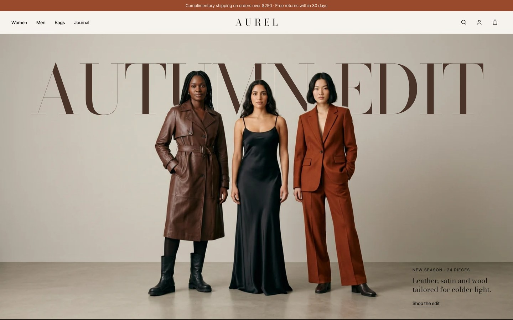

# AUREL — fashion store



Landing page for a fictional fashion label. One HTML file, one stylesheet and one script, no build and nothing to install.

- **Intro:** the wordmark builds letter by letter in the middle of the screen and flies into the header.
- **Hero:** the giant "Autumn Edit" title sits between the photo and a cut-out of the models, so it reads behind them and slides on scroll.
- **Ticker:** runs on its own and speeds up and leans with the scroll speed.
- **Categories:** a big list; hovering a row brings up its photo, which follows the cursor and tilts with the movement.
- **New arrivals:** each card opens with a curtain, swaps to the on-model photo on hover and has a quick add by size.
- **Shop the look:** pulsing hotspots on the photo light up the matching piece in the list; one button adds the full look.
- **Resort banner:** the photo grows from a small card to the full screen while the words move apart.

## Run

```bash
python3 -m http.server 8000
```

Open http://localhost:8000.

## How it works

- Scroll effects run in a single `requestAnimationFrame` loop (`quadro()` in `aurel.js`); reveals use `IntersectionObserver` and CSS transitions.
- Products, categories and the look live in the `PRODUTOS`, `CATS` and `LOOK` lists at the top of `aurel.js`. Each product has a still photo (`img/p-*.webp`) and an on-model photo (`img/m-*.webp`).

## Credits

- Fonts: Bodoni Moda and Inter Tight (SIL Open Font License), from Google Fonts.
- Photos were generated with AI for this demo.
- AUREL is a fictional brand.

## License

MIT. See [LICENSE](LICENSE).
